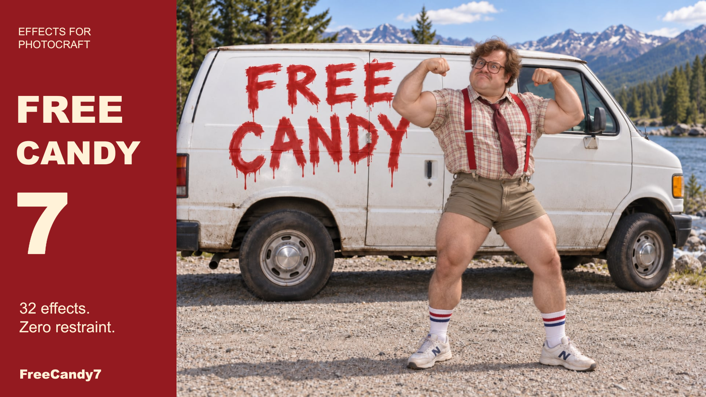
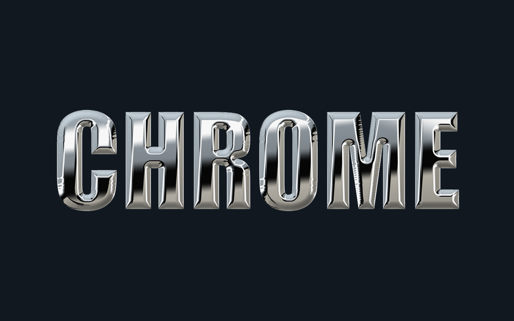
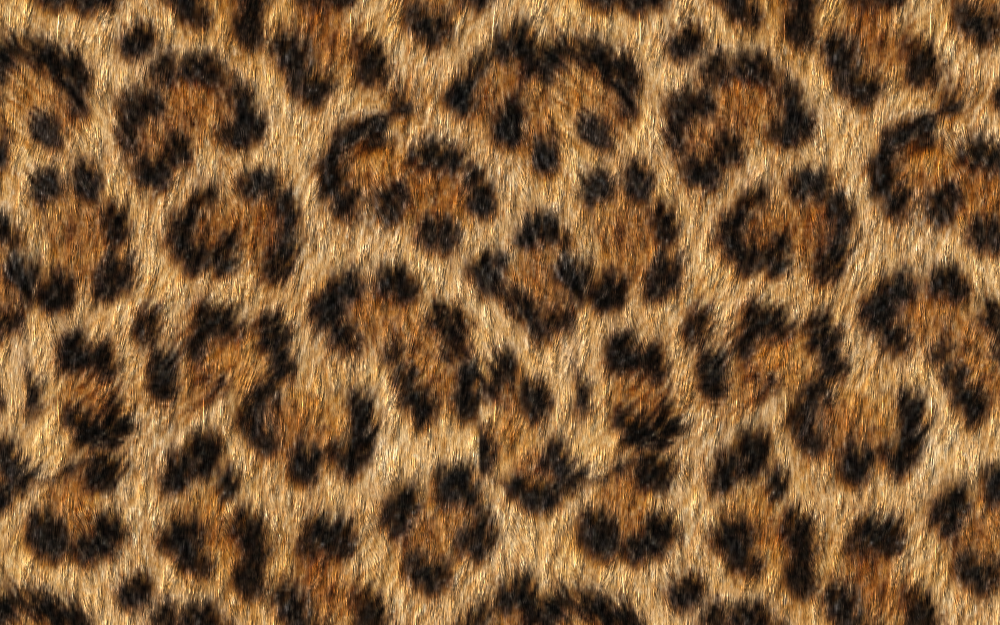
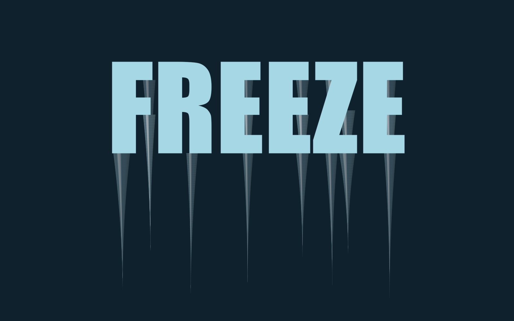
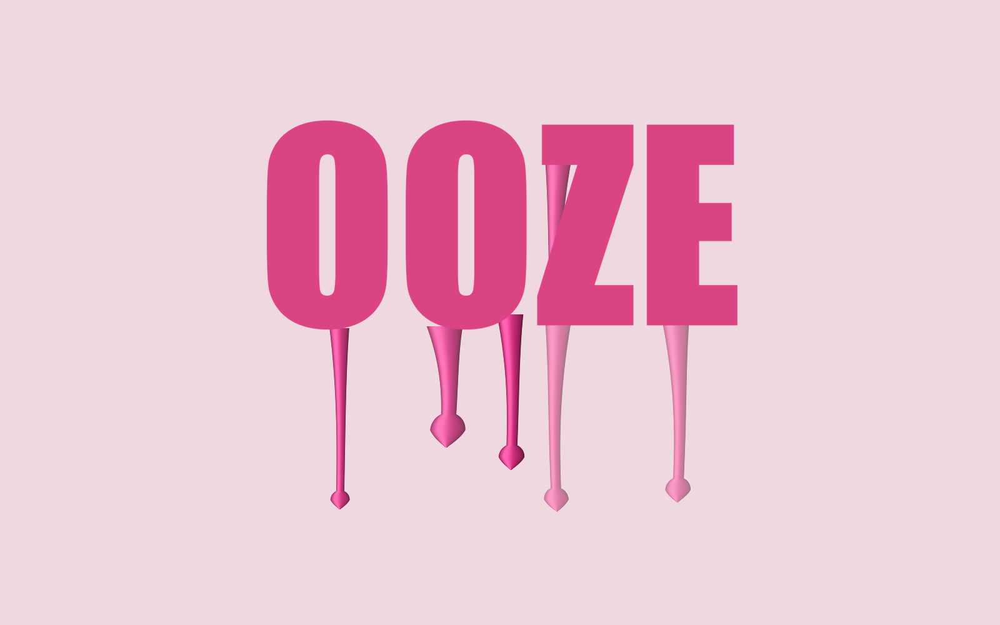
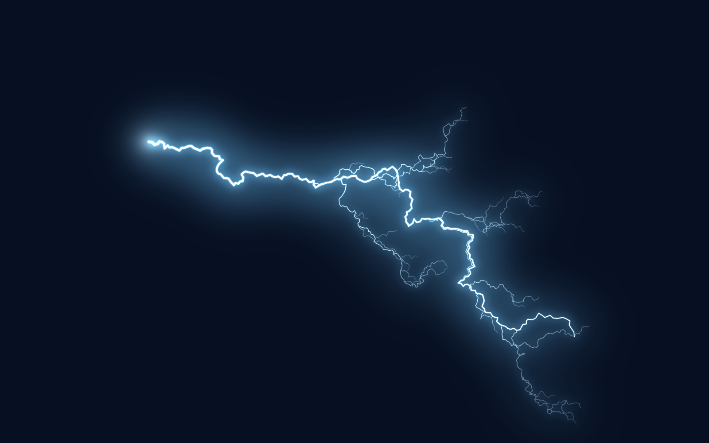
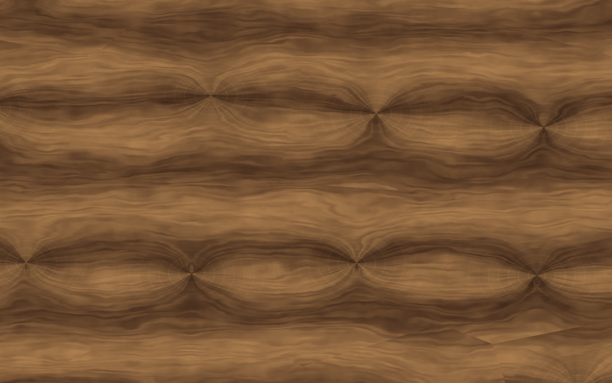
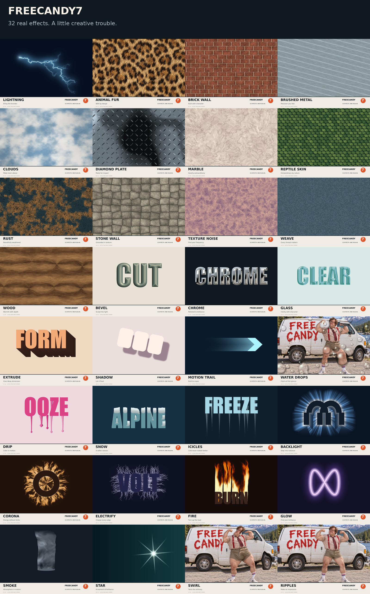

# FreeCandy7 for PhotoCraft

**32 effects. One sweet plug-in.**

Current version: **0.13.0**.



FreeCandy7 gives your artwork reflective metal, fur, fire, ice, liquid drips, lightning, and a full collection of procedural textures. It installs as one WebAssembly plug-in, with one **Effect** dropdown and controls that follow the effect you choose.

> **Requires our PhotoCraft fork for now.** Use the **`codex/desktop-large-plugin-effects`** branch of **[Josephur/photocraft](https://github.com/Josephur/photocraft/tree/codex/desktop-large-plugin-effects)**. The host changes that support this suite are still moving through the PR process. The standard upstream release does not yet include all required support. This requirement stays in place until those changes are settled and available upstream.

## A taste of the effects

These are actual FreeCandy7 renders. Click any image for the full-size result.

| Chrome | Animal Fur |
|---|---|
| [](docs/showcase/chrome.png) | [](docs/showcase/animal-fur.png) |
| **Studio reflections and rounded edges.** | **Six coat materials with adjustable hair and lighting.** |

| Icicles | Drip |
|---|---|
| [](docs/showcase/icicles.png) | [](docs/showcase/drip.png) |
| **Size and jitter for cold, uneven edges.** | **Bigger drops, longer drips, and varied shapes.** |

| Lightning | Wood |
|---|---|
| [](docs/showcase/lightning.png) | [](docs/showcase/wood.png) |
| **A bolt you can place and shape.** | **Grain, knots, color, and scale in one material.** |

## All 32 effects

[](docs/showcase/all-32-effects.jpg)

| Family | Effects |
|---|---|
| Textures | Animal Fur, Brick Wall, Brushed Metal, Clouds, Diamond Plate, Marble, Reptile Skin, Rust, Stone Wall, Texture Noise, Weave, Wood |
| Materials and object edges | Bevel, Chrome, Glass, Extrude, Shadow, Motion Trail, Water Drops, Drip, Snow, Icicles |
| Lighting, atmosphere, and distortion | Lightning, Backlight, Corona, Electrify, Fire, Glow, Smoke, Star, Swirl, Ripples |

## Advertising artwork

Five finished 1920 × 1080 ads feature the campaign photograph and actual rendered effects:

1. [FreeCandy7 campaign hero](docs/showcase/advert-01.png)
2. [Fire and Smoke](docs/showcase/advert-02.png)
3. [Icicles and Snow](docs/showcase/advert-03.png)
4. [Chrome, Wood, and Animal Fur](docs/showcase/advert-04.png)
5. [32 effects, one plug-in](docs/showcase/advert-05.png)

## Made for the artwork in front of you

- **One plug-in, focused controls.** Choose an effect and see its settings, presets, and relevant canvas handles. Switching effects keeps your adjusted values.
- **Shape effects on photos or transparent artwork.** Select an area of a pixel layer, or use the layer's existing alpha silhouette. Shadows, drips, and atmospheric effects can grow beyond that shape while preserving the surrounding image.
- **Built-in recipes and your own presets.** Start with an original recipe, adjust it, and use **Save As** to keep a personal preset. Built-ins remain protected.
- **Real size and variation controls.** Drip and Icicles have separate Size and Size jitter controls. Large-image settings change the rendered geometry.
- **Local rendering.** The installed plug-in runs deterministic code on your computer. It does not call an image service, load a model, or make network requests.

Textures fill a surface by default. Enable **Preserve transparency** to keep them inside existing artwork. Water Drops and Ripples act on image detail. Swirl can generate a texture or distort the input, and Star can draw a star or flare. Lightning remains the default effect.

## Install and use

1. Install or build the **`codex/desktop-large-plugin-effects`** branch of the **[PhotoCraft fork](https://github.com/Josephur/photocraft/tree/codex/desktop-large-plugin-effects)**. This host requirement is temporary while the supporting PRs are resolved.
2. Download the bundled **[freecandy7.wasm](plugins/lightning/dist/freecandy7.wasm)**, or build it using the instructions below.
3. Put the module in your PhotoCraft plug-in folder and configure that folder under **Edit → Preferences → Plug-ins**. Reopen PhotoCraft if it was already running when the module changed.
4. Open **Filter → Plug-ins → FreeCandy7**, then choose an **Effect**.

For a shape effect on a photograph, make a selection on a pixel layer before opening the plug-in. Without a selection, shape effects follow existing transparency. There is no automatic subject detection. Selected shape effects require a pixel layer; rasterize a smart object explicitly, or clear the selection to use the normal smart-filter workflow.

## Build

The crate for the entire suite lives in `plugins/lightning/` for historical reasons. It produces one module, `plugins/lightning/dist/freecandy7.wasm`.

```sh
rustup target add wasm32-unknown-unknown
./plugins/lightning/build.sh
```

Run the plug-in checks:

```sh
cargo test --manifest-path plugins/lightning/Cargo.toml
cargo clippy --manifest-path plugins/lightning/Cargo.toml --all-targets -- -D warnings
cargo clippy --manifest-path plugins/lightning/Cargo.toml --target wasm32-unknown-unknown -- -D warnings
```

## Implementation and current limits

FreeCandy7 is an independent, clean-room implementation. Its effects and starter recipes are original. The showcase presents the current renderer's output, including its visual limits; it is not a promise of photographic realism for every effect or setting.

- RGB and grayscale support covers 8-, 16-, and 32-bit depth. The plug-in rejects CMYK and Lab rather than treating those channels as RGB.
- Glass samples the active layer. It does not refract a separate layer underneath it.
- Shadow currently creates directional offset shadows. It does not provide full perspective projection or reflection controls.
- Preview runs at full document resolution so pixel sizes and selection geometry agree with Apply. Large images and expensive settings can take longer or reach the host's sandbox limits. Maximum-height Fire on the tested 6000 × 4000 image still reaches the 60-second deadline; use a smaller height or a smaller document for that case.
- Desktop and browser hosts have different processing limits. The current large-effect workflow requires the supporting desktop host changes in our fork.

Animal Fur embeds six synthetic coat materials created during development, then applies deterministic local sampling, shading, relief, and edge hairs. The plug-in does not generate those source materials at runtime.

The showcase uses actual effect output from PhotoCraft’s WASM runtime, placed on flat backgrounds for presentation. The effect pixels were not painted over or replaced by generated art. The campaign image was supplied for this project and appears intact in the hero artwork. It also serves as the source image for the Water Drops, Swirl, and Ripples examples.

## License

FreeCandy7 uses the [Zero-Clause BSD license (0BSD)](LICENSE): use, copy, modify, and distribute it for any purpose, with or without a fee. No attribution or source-publication requirement is imposed by this license. The bundled `libm` dependency retains its [third-party notices](plugins/lightning/LICENSE-THIRD-PARTY).
